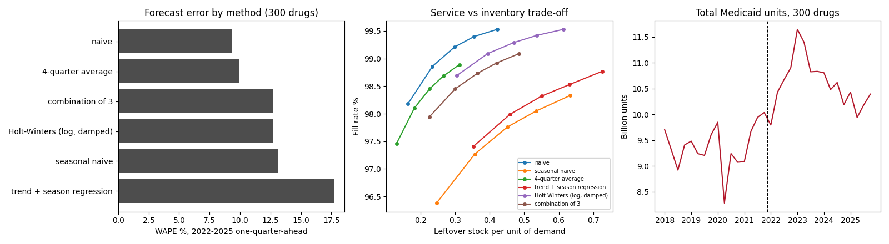

# Drug demand forecasting and inventory simulation (Medicaid, 300 drugs)

How well can you forecast next quarter's demand for a drug, and what does a forecast error cost in stock? I built six forecasting methods from scratch (numpy only), backtested them on 300 high-volume drugs, and then ran each method through a simple inventory policy to compare fill rate against stock held.

The result is not the one I expected going in. The plainest method, "next quarter equals last quarter", beat everything else on error and on the service-versus-stock trade-off. I kept that result because it is what the data says.

## Data

CDC/CMS Medicaid State Drug Utilization Data, national totals (state code XX), quarterly units reimbursed per product, 2018 Q1 to 2025 Q4 (32 quarters). Source: https://data.medicaid.gov, datasets "State Drug Utilization Data 2018" to "2025". `src/fetch.py` pulls and sums them through the datastore API, `src/prep.py` builds the panel.

From 10,081 product names, 2,635 have a positive record in all 32 quarters. I took the 300 with the most units. They hold 85.5% of all units in the data. The panel is in `data/panel_top300.csv`. The yearly raw pulls are about 1 MB each and not stored here.

## Methods

All forecasts are one quarter ahead, from an expanding history, scored on 16 quarters (2022 Q1 to 2025 Q4) for each of the 300 drugs (4,800 forecasts per method).

- Naive: last quarter.
- Seasonal naive: the same quarter last year.
- 4-quarter average.
- Regression: log units on a linear trend and quarter dummies, last 16 quarters.
- Holt-Winters: damped-trend additive model on log units, smoothing parameters picked per series and origin by grid search on one-step squared error.
- Combination: simple average of Holt-Winters, regression and seasonal naive.

Inventory simulation: each quarter the stock on hand is raised to the forecast plus a safety margin of z times the standard deviation of the last 8 relative forecast errors (z from a target service level of 80% to 99%). Unsold stock carries over, unmet demand is lost. Output is fill rate (share of demand served) and leftover stock per unit of demand.

## Results

| Method | WAPE | Median abs. % error | Bias |
|---|---|---|---|
| Naive | 9.3% | 4.9% | -0.2% |
| 4-quarter average | 9.9% | 6.1% | -0.6% |
| Holt-Winters | 12.7% | 4.8% | +5.7% |
| Combination of 3 | 12.7% | 6.3% | +4.2% |
| Seasonal naive | 13.1% | 8.8% | -1.3% |
| Regression | 17.7% | 7.8% | +8.3% |

WAPE is total absolute error divided by total actual units. Full numbers are in `data/forecast_accuracy.csv`.

- Naive wins on total error. Holt-Winters has the lowest typical (median) error per drug, but it over-forecasts on a few drugs by a lot, and that is what hurts its total. Regression over-forecasts by 8%.
- Seasonal naive is poor. Quarterly seasonality in Medicaid units is weak for most of these drugs, so copying last year's quarter mostly copies noise.
- I split the drugs into three groups by how noisy their history is (after removing trend and quarterly pattern). In the steadiest third Holt-Winters is best (3.5% WAPE vs 4.0% for naive). In the noisiest third naive is far better (16.9% vs 27.4%). Picking a method per group from the first half of the test period and scoring on the second half gave 9.3% WAPE, against 8.8% for naive alone, so the extra complexity did not pay off here.
- Service vs stock: at about the same leftover stock (0.30 units per unit of demand), naive at a 95% target reaches 99.2% fill rate, Holt-Winters at an 80% target reaches 98.7%. Seasonal naive and regression need far more stock for a lower fill rate.
- Total units dropped sharply in 2020 Q2, then rose strongly from 2022 into early 2023 and drifted back. All the methods lag those turns, which is where most of the error comes from.



## Limits

- This is Medicaid reimbursement data, not a pharmacy's or wholesaler's orders. It is a real, public demand signal for the drugs, but not the demand any one supplier faces, and the Medicaid population changed a lot over these years (I did not model enrollment).
- Quarterly buckets are far coarser than real replenishment (weekly or daily). The inventory simulation shows how forecast error turns into stock and service, not what a real reorder policy should be. There are no lead-time variation, order costs, shelf life, minimum order sizes or costs, so I report stock held rather than a dollar cost.
- Leftover stock looks high because unsold stock is never run down in this simple policy. Compare methods against each other, not against a real inventory level.
- Product names in the data are cut to 10 characters, so one "product" can cover several strengths, forms and manufacturers, and units are mixed (tablets, mL, vials). Units are only comparable within a product.
- Only products present with a positive value in all 32 quarters are used. That leaves out new launches, withdrawn products and very intermittent items, which are the hardest to forecast. The results apply to steady, high-volume drugs.
- Parameters were grid-searched inside each history window and not tuned on the test period. The method-per-group choice used only the first half of the test period.
- Medicaid units can be revised by states after reporting.

## Run it

```
pip install numpy pandas matplotlib
python src/fetch.py     # pulls 8 years, a few minutes (run one year at a time if it times out: python src/fetch.py 2021)
python src/prep.py
python src/analyze.py   # about 10 seconds
```
